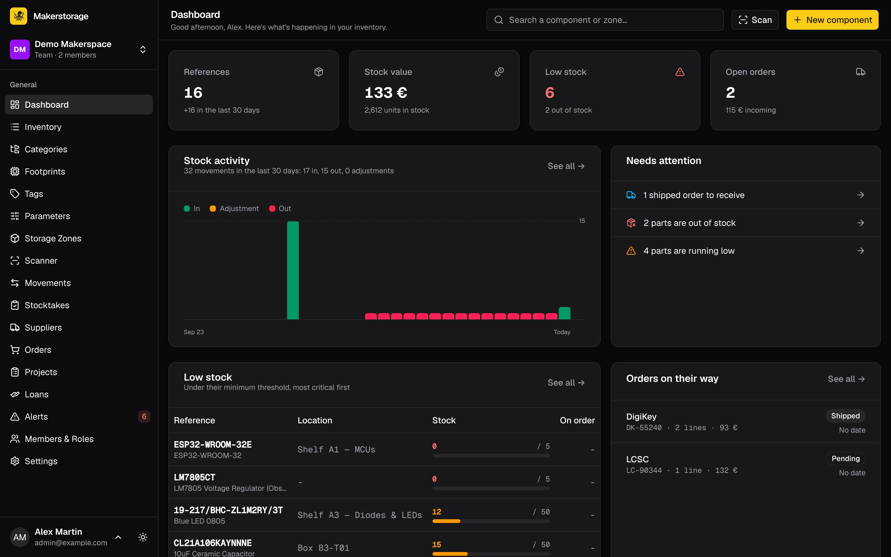

# Makerstorage

[](https://github.com/albanpetit/makerstorage/actions/workflows/test.yml)


A multi-tenant inventory manager for makerspaces and fablabs, purpose-built for electronic components. Catalog parts, keep stock accurate down to the drawer, and reorder before you run out, all scoped per organization.

**[Website](https://makerstorage.io)** · **[Hosted app](https://app.makerstorage.io)** · **[Self-host it](#getting-started)**



## Features

**Inventory**
- **Parts**: SKU / MPN / IPN / barcode, manufacturer, datasheets, images, attached files (app notes, 3D models, firmware…) and per-supplier pricing
- **Classification**: hierarchical categories, reusable footprints and free-form tags
- **Parameters & parametric search**: typed values with units ("4k7", "100nF", "3V3") and range filters, e.g. every 0603 resistor between 1 kΩ and 10 kΩ; categories carry parameter templates
- **Duplicate finder**: spots parts sharing a part number or the same value and footprint, and merges them with their stock and history

**Stock**
- **Storage zones**: a location tree (room → cabinet → shelf → bench → drawer → box), with stock per zone and moves between zones
- **Ledger**: every quantity change is an append-only stock movement
- **Scanning**: look up parts and zones from a phone camera, a webcam or a hardware scanner, even offline: counts and bag receipts wait on the device and are sent once the server answers again
- **Supplier bags**: scan the label on a DigiKey, Mouser or LCSC bag to receive it into stock, or to create the part when it's new
- **QR labels**: print part and zone labels from the browser, or send them straight to a Brother QL or Zebra printer on the local network
- **Stocktakes**: count a zone (typed or scanned, blind counts optional) and post the differences as adjustments, with a list of zones due for a count
- **Loans**: lend tools and parts to members with a due date, then record returns or losses
- **Low-stock alerts**: reorder suggestions from per-part thresholds that account for what's already on order

**Buying**
- **Suppliers & purchase orders**: preferred suppliers, pricing, lead times, and orders tracked from pending to received, with deliveries split across storage zones
- **Mouser, DigiKey & LCSC**: look parts up in the supplier catalogs, import orders, and push a Mouser cart
- **Price breaks & price history**: quantity price breaks per supplier (filled from the catalogs) that orders follow, and each part's purchase prices over time
- **Stock value**: what the stock is worth by category, zone and part, at current, last or average purchase prices, with a CSV export
- **Email digest**: a daily or weekly email of low-stock parts and late orders (needs SMTP)

**Projects & KiCad**
- **Projects**: import a BOM (KiCad, EasyEDA or CSV) or build it by hand, check what you can build, order the shortfall, and deduct parts when you build, with revisions and build history
- **KiCad files**: attach a KiCad project (or link a GitHub repository) and read the BOM straight from its schematics
- **KiCad library**: browse stocked parts in KiCad's symbol chooser (HTTP library) and place them with footprint, MPN, IPN and supplier filled in
- **Reservations**: confirmed projects hold their parts, first come first served, so two projects never count the same stock

**Organizations**
- **Multi-tenant**: every organization has isolated data, its own members invited with roles (owner / admin / member / viewer), and a configurable internal part-number (IPN) scheme
- **Dashboard**: stock value, 30 days of activity, what needs attention, open orders and project buildability
- **Activity log**: admins see who created, changed or deleted parts, zones, orders, projects, members and settings, with before and after values, per member or per record
- **CSV import & backups**: bulk-load parts (UTF-8 or Excel's Windows-1252), export a whole organization as a ZIP and restore it
- **English & French interface**, chosen per user or from the browser
- **Claude & MCP**: a built-in MCP server so Claude (or any MCP client) can check stock, storage locations, project buildability and BOMs against your inventory, and, if you allow it, record stock movements and create or edit parts and projects

## Tech stack

| Layer      | Tools                                                              |
| ---------- | ------------------------------------------------------------------ |
| Backend    | Rails 8.1, SQLite, Devise, Inertia Rails, Solid Queue/Cache/Cable  |
| Frontend   | Inertia.js, React 19, TypeScript, Vite, Tailwind CSS v4, shadcn/ui |
| Deployment | Kamal                                                              |

## Getting started

Don't want to run a server? Create a free account on the hosted instance at
**[app.makerstorage.io](https://app.makerstorage.io)**. It's run by the maintainer on a
best-effort basis, with no SLA; self-host if you need guarantees.

To run your own, Makerstorage ships as a self-contained Docker image (Rails behind Thruster on port
80, using SQLite and local file storage). It needs its own secrets to boot;
configure [SMTP](#email-smtp) as well if you want it to send email.

### Pull the prebuilt image from GHCR

The image is published for both `linux/amd64` and `linux/arm64`; Docker pulls the
right one for your machine.

The prebuilt image carries no secrets you can use: generate your own once, keep
them safe (they sign sessions and encrypt the supplier API keys stored in the
database — losing them makes those keys unreadable), and pass them on every run.

```bash
# Once — store these values somewhere safe and reuse them.
SECRET_KEY_BASE=$(openssl rand -hex 64)
AR_ENCRYPTION_PRIMARY_KEY=$(openssl rand -hex 32)
AR_ENCRYPTION_DETERMINISTIC_KEY=$(openssl rand -hex 32)
AR_ENCRYPTION_KEY_DERIVATION_SALT=$(openssl rand -hex 32)

docker run -d --name makerstorage \
  -p 3000:80 \
  -e SECRET_KEY_BASE="$SECRET_KEY_BASE" \
  -e AR_ENCRYPTION_PRIMARY_KEY="$AR_ENCRYPTION_PRIMARY_KEY" \
  -e AR_ENCRYPTION_DETERMINISTIC_KEY="$AR_ENCRYPTION_DETERMINISTIC_KEY" \
  -e AR_ENCRYPTION_KEY_DERIVATION_SALT="$AR_ENCRYPTION_KEY_DERIVATION_SALT" \
  -v makerstorage-storage:/rails/storage \
  ghcr.io/albanpetit/makerstorage:latest
```

### …or build the image from source

```bash
git clone https://github.com/albanpetit/makerstorage.git
cd makerstorage
docker build -t makerstorage .

docker run -d --name makerstorage \
  -p 3000:80 \
  -e RAILS_MASTER_KEY="$(cat config/master.key)" \
  -v makerstorage-storage:/rails/storage \
  makerstorage
```

The app is then served at `http://localhost:3000`.

- **`RAILS_MASTER_KEY`** decrypts `config/credentials.yml.enc`; it must match the
  credentials baked into the image, so it only applies to an image you built
  from your own credentials. Without it, the secrets come from the environment
  variables shown for the prebuilt image.
- The **`makerstorage-storage` volume** holds the SQLite databases and uploaded
  files — it persists across restarts and is what you back up.
- Background jobs (supplier datasheet downloads, the daily clean-up of orphaned
  uploads) run inside the web server process. Set `SOLID_QUEUE_IN_PUMA=false`
  only if you run `bin/jobs` in a separate container.
- The container runs database migrations on boot and serves a health check at
  **`GET /up`**. Map the port however you like and put a TLS-terminating reverse
  proxy in front of it for production, then set **`FORCE_SSL=true`** (see the
  table below).
- Sign-in, password reset, and sign-up are rate-limited **per client IP**. Run the
  proxy on a private network (same host or Docker network) so Rails trusts its
  `X-Forwarded-For` header; otherwise every visitor appears as the proxy's IP and
  shares a single limit.

### Email (SMTP)

Makerstorage sends transactional email (password resets, email confirmations
and account-security notices) and a daily or weekly digest of low-stock parts
and late purchase orders (chosen in Settings → Notifications; each member can
turn it off from their profile). Point it at any SMTP provider with the
environment variables below. Without `SMTP_ADDRESS` the app still runs, but
no email is delivered — mail is simply skipped and the digest is off.

With SMTP configured, email addresses are verified: a new account signs in
straight away but must confirm its address (from the mailed link, or by
resetting its password) before it sees or answers organization invitations,
and a changed sign-in email only applies once confirmed. Without SMTP there is
no way to confirm, so accounts start out confirmed and email changes apply at
once. Accounts that existed before verification was introduced count as
confirmed.

| Variable              | Default                                | Description                                                              |
| --------------------- | -------------------------------------- | ------------------------------------------------------------------------ |
| `SMTP_ADDRESS`        | —                                      | SMTP server host. **Setting this enables mail delivery.**                |
| `SMTP_PORT`           | `587`                                  | SMTP port.                                                               |
| `SMTP_USERNAME`       | —                                      | SMTP login. When set, the client authenticates.                         |
| `SMTP_PASSWORD`       | —                                      | SMTP password or API token (**secret**).                                |
| `SMTP_TLS`            | `starttls`                             | `starttls` (port 587), `ssl` (implicit TLS, port 465), or `none`.       |
| `SMTP_AUTHENTICATION` | `plain`                                | `plain`, `login`, or `cram_md5`.                                        |
| `SMTP_DOMAIN`         | —                                      | HELO domain, if your provider requires one.                             |
| `MAILER_SENDER`       | `Makerstorage <no-reply@example.com>`  | `From` address (may include a display name).                            |
| `APP_HOST`            | `localhost`                            | Public hostname used to build links in emails (e.g. `parts.example.org`). |
| `APP_PROTOCOL`        | `https` with `FORCE_SSL`, else `http`  | Protocol of links in emails. Set to `https` when a proxy serves HTTPS without `FORCE_SSL`. |
| `FORCE_SSL`           | —                                      | Set to `true` behind a TLS-terminating proxy: redirects to HTTPS, sends HSTS, and marks the session cookie `Secure`. Leave unset for plain-HTTP LAN installs. |
| `CSP_ENFORCE`         | —                                      | Set to `true` to enforce the Content-Security-Policy. By default it is report-only: violations are logged as `[CSP] …` but nothing is blocked. Check those logs before turning it on. |
| `NETWORK_PRINTING`    | on                                     | Set to `false` to turn off direct printing to network label printers (Settings → Label printers), e.g. on a shared instance. When on, the server only connects to local-network addresses (10.x, 172.16–31.x, 192.168.x, 100.64/10, fc00::/7) on printer ports (9100–9109, 6101). |
| `PRIVACY_POLICY_URL`  | —                                      | Your privacy policy, linked from the sign-in pages and the profile. See [Privacy (GDPR)](#privacy-gdpr). |
| `LEGAL_NOTICE_URL`    | —                                      | Your legal notice (e.g. *mentions légales* in France), linked next to it. |

```bash
docker run -d --name makerstorage \
  -p 3000:80 \
  -e SECRET_KEY_BASE="$SECRET_KEY_BASE" \
  -e AR_ENCRYPTION_PRIMARY_KEY="$AR_ENCRYPTION_PRIMARY_KEY" \
  -e AR_ENCRYPTION_DETERMINISTIC_KEY="$AR_ENCRYPTION_DETERMINISTIC_KEY" \
  -e AR_ENCRYPTION_KEY_DERIVATION_SALT="$AR_ENCRYPTION_KEY_DERIVATION_SALT" \
  -e APP_HOST="parts.example.org" \
  -e MAILER_SENDER="Makerstorage <no-reply@example.org>" \
  -e SMTP_ADDRESS="smtp.example.org" \
  -e SMTP_PORT="587" \
  -e SMTP_USERNAME="no-reply@example.org" \
  -e SMTP_PASSWORD="$SMTP_PASSWORD" \
  -e SMTP_TLS="starttls" \
  -v makerstorage-storage:/rails/storage \
  ghcr.io/albanpetit/makerstorage:latest
```

> **Tip:** to avoid a long `-e` list, put the variables in a file and pass
> `--env-file makerstorage.env`. Keep that file out of version control: it holds
> your secrets and `SMTP_PASSWORD`.

For deliverability, add **SPF**, **DKIM**, and **DMARC** DNS records for your
sending domain as instructed by your mail provider.

> Setting up a **development** environment instead? See
> [CONTRIBUTING.md](CONTRIBUTING.md#development-setup). To test real delivery
> locally, put the same `SMTP_*` variables in a gitignored `.env`.

### Claude and other MCP clients

Makerstorage serves a [Model Context Protocol](https://modelcontextprotocol.io)
server at `/mcp`, so you can ask Claude things like "do I have what I need to
build this BOM?" or "where are my 0603 10k resistors?". The read tools search
parts (with value and package filters to find substitutes), show part details
(stock per zone, suppliers, open orders, reservations), check a BOM or a list
of components against stock, list projects and their shortfalls, loans,
storage zones, and give an inventory overview.

If you tick *Allow changes*, Claude can also write: take stock in or out, move
it between zones, record a count, create or edit a part, and create a draft
project from a list of components. Every change goes through the same rules as
the app (no negative stock, one part per bag, unique MPN/SKU) and lands in the
stock ledger under your name, with the assistant's name in the reason
("Used for the workshop (via Claude)"). Nothing can be deleted from Claude.

Access goes through OAuth: when you add the connector, Claude opens a
Makerstorage page where you sign in, pick one of your organizations, and choose
read-only access or *Allow changes* (viewers only get read-only). Your profile
shows the server URL and the connected apps; each one can be switched between
read-only and changes, or disconnected. A member who loses access to the
organization loses API access with it, and one who becomes a viewer loses the
write tools.

- **Claude (web, desktop, mobile)**: Settings → Connectors → *Add custom
  connector*, URL `https://parts.example.org/mcp`, no client ID or secret.
  Claude connects from Anthropic's servers, so the instance must be reachable
  from the internet over HTTPS (set `FORCE_SSL=true` behind your TLS proxy so
  the URLs it advertises are `https`).
- **Claude Code**: `claude mcp add --transport http makerstorage https://parts.example.org/mcp`,
  then `/mcp` in a session to sign in. Claude Code runs on your computer, so a
  LAN install (`http://192.168.1.10:3000/mcp`) works too.

### KiCad library

Makerstorage serves a [KiCad HTTP library](https://docs.kicad.org/9.0/en/eeschema/eeschema_advanced.html#http-libraries)
(KiCad 8 or later), so your stocked parts show up in the symbol chooser, one
library category per Makerstorage category, with their stock count. A placed
part gets its value, KiCad footprint, datasheet link, manufacturer, MPN, IPN,
preferred supplier and SKU as symbol fields, which the BOM import matches back
to the same parts.

Each part uses a symbol from your own KiCad libraries: the part's *KiCad
symbol* if set, else its category's (or the nearest parent's), else a guess
from the category name (`Device:R`, `Device:C`, `Device:LED`…). Parts with no
symbol, and obsolete parts, are left out. The footprint comes from the part's
*KiCad footprint*, else from its Makerstorage footprint's.

An admin turns it on in Settings → KiCad library, which downloads a
`.kicad_httplib` file holding the server URL and the organization's token
(shown once; a new file replaces the token, *Revoke* turns access off). In
KiCad, add that file in Preferences → Manage Symbol Libraries. KiCad must be
able to reach the server: use its LAN or public address, not `localhost`.

### Privacy (GDPR)

Whoever runs an instance is the data controller for its users: on a makerspace's
own server that's the makerspace, not the Makerstorage project. What the app
does for you:

- **No tracking and no consent banner needed**: the only cookies are the
  session, "remember me" and the sidebar state; fonts are served by the app
  itself and no analytics or third-party script is loaded. Part images from
  Mouser, DigiKey or LCSC may be shown straight from their CDN.
- **Erasure**: users delete their account from Profile → Delete account. Organizations nobody else uses go
  with it; elsewhere their history stays but reads "Deleted user".
- **Retention**: activity log entries are deleted after 2 years, and a loan's
  borrower contact is cleared a year after the loan closed (`PurgePersonalDataJob`, daily).
- **Portability**: organization admins download everything as a ZIP (Settings → Backup).
- Integrations an organization turns on (Mouser, DigiKey, LCSC, GitHub, AI-assisted
  entry with Anthropic) send it data with that organization's own keys.

Set `PRIVACY_POLICY_URL` and `LEGAL_NOTICE_URL` to your own pages so they're
linked from the app; [site/src/pages/privacy.astro](site/src/pages/privacy.astro)
is the hosted instance's and can serve as a model.

## How this project is developed

Makerstorage is designed and maintained by Alban Petit, with AI-assisted tooling
([Claude Code](https://claude.com/claude-code)) used during development. Every change
is reviewed, covered by tests and checked in CI before it's merged.

## Contributing

Commit conventions, the local check suite, and other contributor guidelines live in [CONTRIBUTING.md](CONTRIBUTING.md).

## License

Licensed under the [GNU Affero General Public License v3.0](LICENSE) (AGPL-3.0). If you run a modified version of Makerstorage as a network service, you must make your modified source available to its users.
